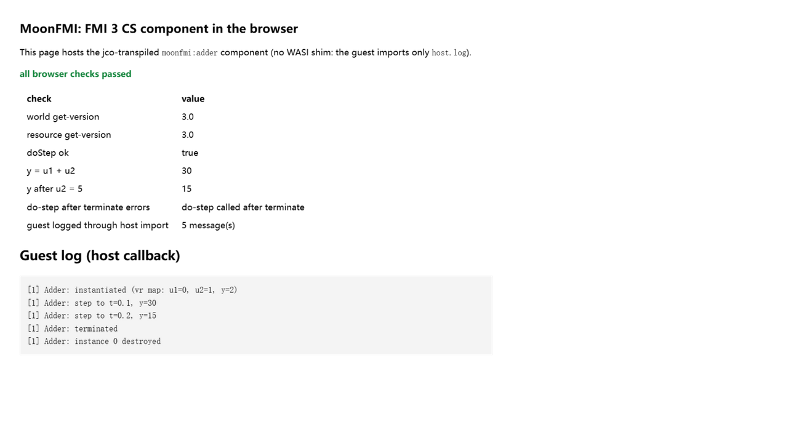

# 浏览器 POC 结果(F-06)

> 日期:2026-11-17。目标:确认 jco 转译的 MoonBit FMI 3 CS 组件能在真实浏览器里
> 实例化并步进,而不只是 Node。

## 环境

- 宿主:ZCode 内置 Chromium 内核浏览器(Playwright/IAB 自动化),1280×720
- 组件:`tests/fmu-wasm/` 的 `moonfmi:adder`(CS resource + `host.log` 导入)
- 构建:`node tests/fmu-wasm/run.mjs browser`(wit-bindgen → moon wasm →
  component embed/new → jco transpile → 静态服务 `127.0.0.1:8123`)

## 页面断言(实测)

| 检查 | 结果 |
| --- | --- |
| `documentElement.dataset.result` | `pass` |
| 世界级 `get-version` | `3.0` |
| 资源 `get-version` | `3.0` |
| `doStep(0, 0.1)` | 成功 |
| `y = u1 + u2` | `30` |
| `u2 = 5` 后再步进 | `y = 15` |
| terminate 后 `doStep` | 抛 `do-step called after terminate`(guest 原文) |
| 宿主回调日志 | 5 条:实例化 / 两次步进(t 与 y 已插值)/ terminate / 析构 |

截图中的日志行 `step to t=0.1, y=30` 与 `t=0.2, y=15` 说明 guest 的字符串
插值、host 回调与数值计算在浏览器里都正常。

## 边界

- 自动化宿主是 Chromium 内核;Firefox 未自动化验证,手工步骤:
  `node tests/fmu-wasm/run.mjs browser`,用 Firefox 打开 `http://127.0.0.1:8123/`,
  期望状态行 `all browser checks passed`。
- 组件只导入 `moonfmi:adder/host`,没有 WASI 导入,因此不需要 preview2-shim;
  一旦 guest 使用文件/时钟等 WASI 能力,浏览器侧需要 WASI shim(设计文档已记录)。
- 这是 POC:页面直接 host 一个手写 Adder 组件,浏览器里没有实现 FMI 主算法,
  也没有 `resources/` 虚拟文件系统。
